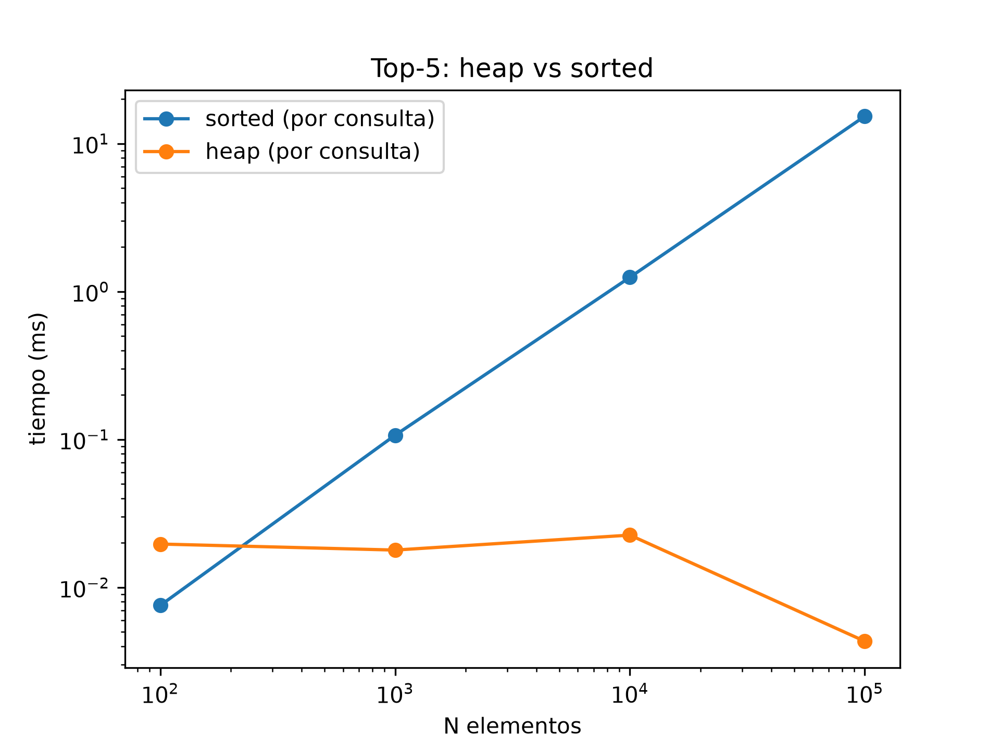

# Análisis TP6 — Cola de prioridad (Heap)

## 1. ¿Qué resolvimos?

Se agregó un nuevo ítem al menú: **"8. Ranking de series"**.
Al ingresarlo pregunta cuántas series mostrar (Top-N) y, por defecto, muestra el Top 5.
La resolución se basa en una **heap binaria máxima** implementada a mano, sin usar `heapq`.

## 2. Implementación de la Heap

Se creó la clase `MaxHeap` en `estructuras/heap.py`, tal cual el código proporcionado por la cátedra (`insert`, `extract_max` y los burbujeos hacia arriba y hacia abajo).

Integración:

- **`main.py`**: se crea el `MaxHeap` y se insertan todas las series del catálogo con `insert`.
- **`ui/consola.py`**: `ver_ranking()` obtiene el Top-N extrayendo el máximo N veces y luego reinserta esas series para que el heap quede intacto para la próxima consulta.

### Función de prioridad

La prioridad de una serie es su **puntuación (rating)**: la serie con mayor puntuación sale primero.
Se implementó con `__gt__` en la clase `Serie`, de modo que el heap compara series directamente con `>` sin modificar el código de la cátedra.

Se eligió el rating porque es el dato que mejor representa "qué recomendar primero" y ya está disponible en todas las series. Una combinación de factores (por ejemplo rating + popularidad) sería una extensión posible, pero el dataset no tiene datos de popularidad.

### Desempate

Si dos series tienen la misma puntuación, `__gt__` devuelve `False` en ambos sentidos y el heap no las intercambia. El orden entre ellas queda determinado por el orden de inserción y la forma del heap, **no por un criterio explícito**.
Por eso en el ejemplo de abajo *The Office*, *Arcane* y *Better Call Saul* (todas 9.0) aparecen en un orden que no tiene significado. Si se quisiera un desempate determinista (por ejemplo, alfabético por título), habría que ampliar `__gt__` para comparar `(puntuacion, título)`.

## 3. Salida de consola

```
==============================================================
        🎥   BIENVENIDO A SERIEMATCH (CLI Edition)  🎥
==============================================================
1. Registrar usuario
2. Agregar serie
3. Ver series
4. Buscar serie por titulo
5. Dejar reseña
6. Filtrar por género
7. Explorar categorías
8. Ranking de series
0. Salir
Seleccione una opción: 8
¿Cuántas series quiere ver en el ranking? [5]: 10

=== TOP 10 SERIES POR PUNTUACIÓN ===
🥇 Breaking Bad                        9.5
🥈 Chernobyl                           9.3
🥉 Game of Thrones                     9.2
4. Sherlock                            9.1
5. The Office                          9.0
6. Arcane                              9.0
7. Better Call Saul                    9.0
8. Friends                             8.9
9. Succession                          8.9
10. Peaky Blinders                      8.8
```

## 4. Experimento: heap vs `sorted`

Script: `algoritmos/experimentos/medicion_heap.py`
Ejecutar con: `python -m algoritmos.experimentos.medicion_heap`

Se compara obtener el **Top 5 por puntuación** de dos maneras:

- **sorted**: `sorted(series, key=puntuacion, reverse=True)[:5]` en cada consulta.
- **heap**: heap ya construida; se hacen 5 `extract_max` y 5 `insert` para reinsertarlos.

Además se mide el costo de construir la heap (n inserciones) y el de insertar una serie nueva.

Salida de consola:

```
Top-5 por puntuación

tamaño  sorted_ms       construir_heap_ms       heap_ms insert_ms       consultas_equilibrio
¡Éxito! Se cargaron 100 series al catálogo.
100     0.0075          0.0538          0.0196  0.0003          nunca
¡Éxito! Se cargaron 1000 series al catálogo.
1000    0.1067          0.7648          0.0179  0.0006          8.6
¡Éxito! Se cargaron 10000 series al catálogo.
10000   1.2470          6.4170          0.0225  0.0005          5.2
¡Éxito! Se cargaron 100000 series al catálogo.
100000  15.2931         61.4435         0.0043  0.0004          4.0
```

| n | sorted (ms) | construir heap (ms) | Top-5 heap (ms) | insert (ms) | consultas de equilibrio |
|---|---|---|---|---|---|
| 100 | 0.0075 | 0.0538 | 0.0196 | 0.0003 | nunca |
| 1.000 | 0.1067 | 0.7648 | 0.0179 | 0.0006 | 8.6 |
| 10.000 | 1.2470 | 6.4170 | 0.0225 | 0.0005 | 5.2 |
| 100.000 | 15.2931 | 61.4435 | 0.0043 | 0.0004 | 4.0 |

*Consultas de equilibrio* = cantidad de consultas a partir de la cual construir la heap y consultarla resulta más barato que ordenar en cada consulta.



### Lectura de los resultados

- `sorted` crece con n (de 0,01 ms a 15 ms), mientras que consultar el Top-5 en la heap se mantiene en el orden de centésimas de milisegundo.
- Con n = 100 `sorted` es más rápido: con pocos datos la diferencia no importa y `sorted` está implementado en C.
- Construir la heap con inserciones cuesta más que un `sorted` (es O(n log n) en Python puro). Para **una sola consulta** conviene `sorted`; a partir de unas 4 a 9 consultas la heap ya se amortiza.
- Los tiempos del Top-5 en la heap son aún más bajos de lo esperado porque el dataset tiene muchas series con la misma puntuación: con empates, los burbujeos se detienen enseguida. Con puntuaciones todas distintas el costo sería algo mayor, pero seguiría creciendo en forma logarítmica.

## 5. Conclusión y justificación

**¿Por qué una heap y no ordenar todo el dataset cada vez?**

| Operación | Ordenar cada vez | Heap |
|---|---|---|
| Armado inicial | — | O(n log n) (n inserciones) |
| Top-N | O(n log n) | O(N log n) |
| Insertar una serie nueva | O(n log n) (re-ordenar) | O(log n) |

*(n = cantidad de series, N = cantidad pedida en el ranking)*

- Para el ranking solo interesan las primeras N series, y ordenar todo el catálogo ordena también las n − N que nunca se muestran.
- El catálogo es dinámico: cada serie nueva o cada cambio de puntuación obligaría a reordenar todo, mientras que en la heap es una inserción de O(log n).
- Como el experimento muestra, la heap **no gana siempre**: para una única consulta sobre un dataset chico `sorted` alcanza. Su ventaja aparece cuando el ranking se consulta varias veces y el catálogo crece, que es el uso real de la aplicación.
