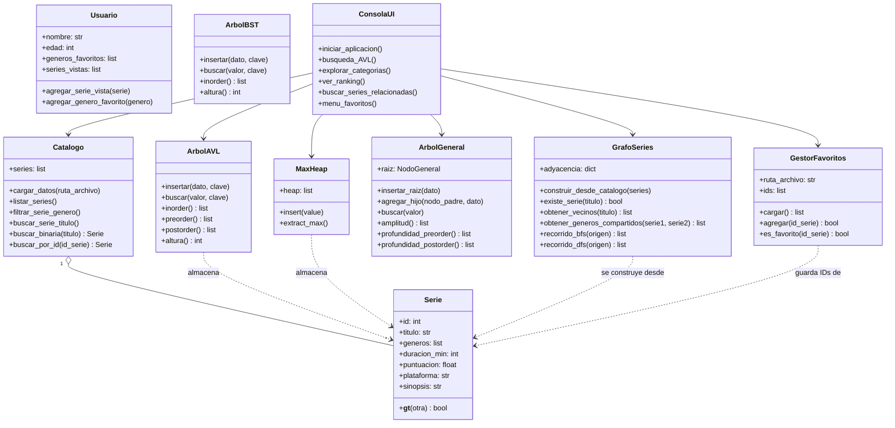

# SerieMatch — Documentación final

Este documento cierra el proyecto: resume la propuesta inicial (TP0), describe el resultado final y compara ambos de forma explícita, indicando qué se cumplió, qué cambió y qué quedó pendiente.

**Integrantes:** Violeta Curto · Tomás Aybar · ~~Mateo Luquetti~~ *(DNF)*

---

## 1. Resumen

SerieMatch es una aplicación de consola en Python para descubrir series. Carga un catálogo desde un archivo JSON y permite listarlo, buscar series por título, filtrarlas y explorarlas por género, ver un ranking por puntuación, obtener series relacionadas con una serie dada y guardar series en una lista de favoritos que persiste en un archivo.

El proyecto se desarrolló a lo largo de los TPs de la materia: cada TP incorporó una estructura de datos, y cada una se integró a la aplicación en la funcionalidad donde resultaba útil.

---

## 2. La propuesta (TP0)

Detalle completo en [00-propuesta.md](00-propuesta.md) y [01-requerimientos.md](01-requerimientos.md).

- **Problema:** el "scroll infinito" y el tiempo que se pierde sin saber qué ver ("¿Qué miramos hoy?").
- **Usuario objetivo:** fanáticos de las series que pasan más tiempo buscando qué ver que viéndolas.
- **Idea central:** recomendar series a partir de un mini test sobre el estado de ánimo y las preferencias del usuario.

### Funcionalidades propuestas

| ID | Funcionalidad |
|---|---|
| F1 | Mini test interactivo para preparar las recomendaciones |
| F2 | Indicar en qué plataforma de streaming se puede ver la serie |
| F3 | Guardar recomendaciones en una lista de favoritos |
| F4 | Proveer el enlace al tráiler oficial |
| F5 | Ranking de las series mejor valoradas |

### Requerimientos propuestos

| ID | Requerimiento |
|---|---|
| RF01 | Presentar un cuestionario interactivo de 3 preguntas al iniciar |
| RF02 | Recomendar series según las respuestas del cuestionario y el dataset |
| RF03 | Guardar una serie en una lista de favoritos |
| RF04 | Detallar en qué plataforma de streaming está disponible la serie |
| RF05 | Generar y mostrar un ranking con las series mejor puntuadas |
| RNF01 | Desarrollado íntegramente en Python |
| RNF02 | La lista de favoritos debe persistir localmente en un archivo |
| RNF03 | Las recomendaciones deben responder en menos de 2 segundos |

---

## 3. El resultado final

### 3.1 Menú de la aplicación

```
==============================================================
        🎥   BIENVENIDO A SERIEMATCH (CLI Edition)  🎥
==============================================================
1. Registrar usuario
2. Agregar serie
3. Ver series
4. Buscar serie por titulo
5. Dejar reseña
6. Filtrar por género
7. Explorar categorías
8. Ranking de series
9. Buscar series relacionadas por género
10. Favoritos
0. Salir
```

| Opción | Qué hace | Estructura que usa | Estado |
|---|---|---|---|
| 1. Registrar usuario | — | — | No implementada (solo muestra el título de la opción) |
| 2. Agregar serie | — | — | No implementada (solo muestra el título de la opción) |
| 3. Ver series | Lista todo el catálogo con ID, título, plataforma y puntuación | Lista (`Catalogo`) | Funcional |
| 4. Buscar serie por título | Busca una serie por título exacto, sin distinguir mayúsculas | Árbol AVL | Funcional |
| 5. Dejar reseña | — | — | No implementada (solo muestra el título de la opción) |
| 6. Filtrar por género | Muestra las series cuyo género contiene el texto ingresado | Lista (`Catalogo`) | Funcional |
| 7. Explorar categorías | Lista los géneros y, al elegir uno, sus series | Árbol general | Funcional |
| 8. Ranking de series | Top-N por puntuación (por defecto Top 5) | Heap máxima | Funcional |
| 9. Buscar series relacionadas | Series que comparten géneros con una serie dada, ordenadas por cantidad de géneros en común | Grafo | Funcional |
| 10. Favoritos | Muestra los favoritos guardados y permite agregar una serie indicando su ID | Archivo de texto (`GestorFavoritos`) | Funcional |

### 3.2 Favoritos

- Los favoritos se guardan en `datos/favoritos.txt`, con un ID de serie por línea. Se leen y se escriben con `with open`.
- Cada vez que se entra a la opción 10 se lee el archivo y se muestran las series guardadas.
- "Agregar a favoritos" muestra el listado del catálogo y pide el ID. El ID se agrega al final del archivo, así que los favoritos se conservan al cerrar la aplicación.
- Si el ID ya está en favoritos, no se duplica; si no es un número o no existe en el catálogo, se informa.
- Si el archivo no existe, la lista arranca vacía y el archivo se crea al agregar el primer favorito.
- El archivo está en `.gitignore`: los favoritos son de cada usuario y no forman parte del repositorio.

### 3.3 Dataset

- Archivo: `datos/series.json`.
- **45 series**, **25 géneros** y **7 plataformas** (Netflix, Disney+, HBO Max, Prime Video, Max, Apple TV+, Peacock).
- Cada serie tiene: ID, título, géneros, duración por episodio, puntuación, plataforma y sinopsis.
- Para los experimentos de rendimiento se generaron datasets sintéticos de 100, 1.000, 10.000 y 100.000 series con `datos/generar.py` (carpeta `datos/generados/`).
- Durante el TP7 se corrigieron dos problemas de datos: se unificó un registro duplicado de *Stranger Things* y se unificó la escritura del género "Ciencia ficción" (ver [10-tp7-grafos.md](10-tp7-grafos.md)).

---

## 4. Propuesta vs. resultado

### 4.1 Funcionalidades

| Propuesta | Resultado | Estado |
|---|---|---|
| F1 — Mini test | No se implementó. | ❌ No implementada |
| F2 — Dónde verla | Cada serie tiene su plataforma y se muestra al listar el catálogo, al buscar por título y al filtrar por género. No hay una vista de detalle con enlace directo, como mostraba el ejemplo de la propuesta. | 🟡 Parcial |
| F3 — Favoritos | Opción 10: se agregan series por ID y se guardan en un archivo de texto. | ✅ Cumplida |
| F4 — Tráiler oficial | No se implementó (el dataset no incluye enlaces a tráileres). | ❌ No implementada |
| F5 — Ranking | Opción 8, implementada con una heap máxima. | ✅ Cumplida |

### 4.2 Requerimientos

| ID | Resultado | Estado |
|---|---|---|
| RF01 | No hay cuestionario. | ❌ |
| RF02 | Hay recomendaciones, pero se basan en **los géneros compartidos con una serie elegida por el usuario** (opción 9, grafo), no en las respuestas de un cuestionario. | 🟡 Parcial |
| RF03 | Lista de favoritos en la opción 10. | ✅ |
| RF04 | La plataforma se muestra junto a cada serie (ver F2). | 🟡 Parcial |
| RF05 | Ranking Top-N con heap (opción 8). | ✅ |
| RNF01 | Todo el proyecto está en Python, sin librerías externas para las estructuras (matplotlib solo se usa para graficar los experimentos). | ✅ |
| RNF02 | Los favoritos se guardan en `datos/favoritos.txt` y se conservan al cerrar la aplicación. | ✅ |
| RNF03 | Cargar el catálogo, construir el grafo y obtener las relacionadas de una serie con sus géneros compartidos toma alrededor de 8 ms. | ✅ |

### 4.3 Alcance

Lo definido como fuera de alcance se respetó: no hay múltiples usuarios simultáneos, no hay autenticación, no hay interfaz gráfica y no se reproduce video.

### 4.4 Funcionalidades que no estaban en la propuesta

- **Buscar por título** con árbol AVL (opción 4).
- **Filtrar por género** (opción 6).
- **Explorar categorías** con árbol general (opción 7).
- **Series relacionadas por género** con grafo (opción 9). Es la funcionalidad que más se acerca a la idea original de recomendar: en vez de partir de un cuestionario, parte de una serie que al usuario le gusta.

### 4.5 ¿Por qué cambió el alcance?

El proyecto se organizó según los TPs de la materia, en los que cada etapa pedía incorporar una estructura de datos y justificar su uso dentro del dominio. El desarrollo se concentró en esas estructuras y en integrarlas a funcionalidades concretas de la aplicación. Las funcionalidades de la propuesta que no se apoyaban en ninguna de ellas quedaron para el final. De esas, se implementó la lista de favoritos con persistencia en archivo; el mini test y el tráiler quedaron como trabajo futuro.

---

## 5. Estructuras de datos por TP

| TP | Estructura / tema | Archivo | Uso en la aplicación | Documentación |
|---|---|---|---|---|
| TP1 | Modelo del dominio y carga de datos | `modelos/serie.py`, `modelos/catalogo.py` | Catálogo en memoria (opciones 3 y 6) | — |
| TP2/TP3 | Búsqueda secuencial, búsqueda binaria y BST | `modelos/catalogo.py`, `estructuras/arbol_binario.py` | El BST se usó en el TP3 y luego se reemplazó por el AVL; hoy se usa solo en experimentos | [07-analisis-tp3.md](07-analisis-tp3.md) |
| TP4 | Árbol AVL | `estructuras/avl.py` | Búsqueda por título (opción 4) | [08-analisis-tp4-tp5.md](08-analisis-tp4-tp5.md) |
| TP5 | Árbol general (n-ario) | `estructuras/arbol_general.py` | Explorar categorías (opción 7) | [08-analisis-tp4-tp5.md](08-analisis-tp4-tp5.md) |
| TP6 | Heap máxima (cola de prioridad) | `estructuras/heap.py` | Ranking por puntuación (opción 8) | [09-tp6-heap.md](09-tp6-heap.md) |
| TP7 | Grafo no dirigido | `estructuras/grafo.py` | Series relacionadas (opción 9) | [10-tp7-grafos.md](10-tp7-grafos.md) |
| Cierre | Persistencia en archivo de texto | `modelos/favoritos.py` | Favoritos (opción 10) | Este documento, sección 3.2 |

### Por qué cada estructura

- **AVL:** el BST del TP3 se degenera en una lista cuando los títulos se insertan en orden alfabético (altura 100 con 100 datos y `RecursionError` con 10.000). El AVL se rebalancea con rotaciones y mantiene la altura en O(log n) (altura 7 con los mismos 100 datos).
- **Árbol general:** los géneros forman una jerarquía natural (Catálogo → Género → Serie) con una cantidad variable de hijos por nodo.
- **Heap:** para el ranking solo interesan las N mejores series. Obtenerlas cuesta O(N log n) sin ordenar todo el catálogo, e insertar una serie nueva cuesta O(log n).
- **Grafo:** "¿qué series se parecen a esta?" es una relación entre pares de series, que ninguna de las estructuras anteriores representa.

---

## 6. Arquitectura final

### 6.1 Conexión entre estructuras

```
datos/series.json
      │
      ▼
  Catalogo  ──(lista de Serie)──┬──► GrafoSeries     (géneros compartidos)
                                ├──► ArbolAVL        (clave: título en minúsculas)
                                ├──► ArbolGeneral    (Catálogo → Género → Título)
                                └──► MaxHeap         (prioridad: puntuación)
                                          │
                                          ▼
datos/favoritos.txt ◄──► GestorFavoritos ──► ConsolaUI  (menú de opciones)
```

Todas las estructuras se construyen una sola vez al iniciar, a partir de la misma lista de series, y se pasan a `ConsolaUI`. `GestorFavoritos` lee y escribe el archivo de favoritos cada vez que se usa la opción 10. El detalle de qué guarda cada estructura está en [04-diagrama-datos.md](04-diagrama-datos.md).

### 6.2 Diagrama de clases final

Reemplaza al boceto inicial de [03-diagrama-clases.md](03-diagrama-clases.md), que corresponde al TP0.



- `ArbolBST` se conserva para los scripts de prueba y experimentos del TP3/TP4; la aplicación usa `ArbolAVL`.
- `Usuario` está modelada pero todavía no se usa en la aplicación (corresponde a las opciones 1 y 5, no implementadas).

---

## 7. Limitaciones conocidas y trabajo futuro

**Funcionalidades pendientes**

- Mini test y recomendaciones según sus respuestas (F1 / RF01 / RF02).
- Quitar series de favoritos (hoy solo se pueden agregar).
- Enlace al tráiler y vista de detalle con enlace a la plataforma (F2, F4).
- Opciones del menú sin implementar: registrar usuario, agregar serie y dejar reseña.

**Observaciones técnicas**

- **Búsqueda binaria (TP3):** `Catalogo.buscar_binaria` arma la lista de claves en cada llamada, lo que cuesta O(n). Por eso, en las mediciones del TP3, la búsqueda binaria no resultó más rápida que la secuencial. Para que sea O(log n), la lista de claves debería construirse una sola vez.
- **Grafo denso:** con los géneros actuales el grafo tiene una densidad del 71,5 %, porque géneros amplios como "Drama" conectan casi todo el catálogo. Una mejora posible es ponderar las aristas por cantidad de géneros compartidos o exigir un mínimo de coincidencias.
- **Construcción del árbol de categorías:** por cada serie y género se hace una búsqueda en amplitud sobre todo el árbol. Con un diccionario de géneros a nodos, cada búsqueda sería O(1).
- **Géneros similares:** "Historia" e "Histórico" figuran como géneros distintos.

---

## 8. Cómo ejecutar

```bash
pip install -r requirements.txt
python main.py
```

Scripts de prueba y experimentos:

```bash
python -m algoritmos.probar_bst                  # TP3: BST
python -m algoritmos.probar_avl                  # TP4/TP5: AVL y árbol general
python -m algoritmos.probar_grafo                # TP7: grafo
python -m algoritmos.experimentos.medicion       # TP3: secuencial vs binaria vs BST
python -m algoritmos.experimentos.medicion_heap  # TP6: heap vs sorted
```

> Los scripts de experimentos sobrescriben los gráficos de `docs/capturas/` con mediciones nuevas.

---

## 9. Índice de la documentación

| Documento | Contenido |
|---|---|
| [00-propuesta.md](00-propuesta.md) | Propuesta inicial (TP0) |
| [01-requerimientos.md](01-requerimientos.md) | Requerimientos (TP0) |
| [03-diagrama-clases.md](03-diagrama-clases.md) | Boceto de diagrama de clases (TP0) |
| [04-diagrama-datos.md](04-diagrama-datos.md) | Conexión entre estructuras |
| [05-gestion-proyecto.md](05-gestion-proyecto.md) | Metodología y organización del equipo |
| [07-analisis-tp3.md](07-analisis-tp3.md) | TP3: BST y comparación de búsquedas |
| [08-analisis-tp4-tp5.md](08-analisis-tp4-tp5.md) | TP4 y TP5: AVL y árbol general |
| [09-tp6-heap.md](09-tp6-heap.md) | TP6: heap y ranking |
| [10-tp7-grafos.md](10-tp7-grafos.md) | TP7: grafo y series relacionadas |
| **11-documentacion-final.md** | Este documento |
| [presentacion/03-guia-estudio.md](presentacion/03-guia-estudio.md) | Guía de estudio para la exposición |
